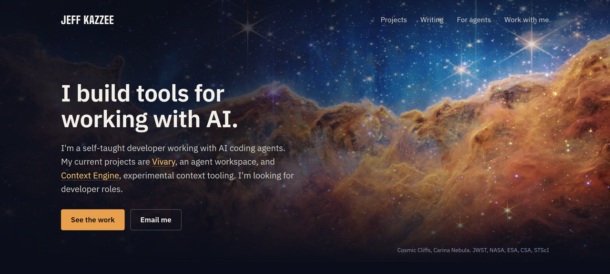
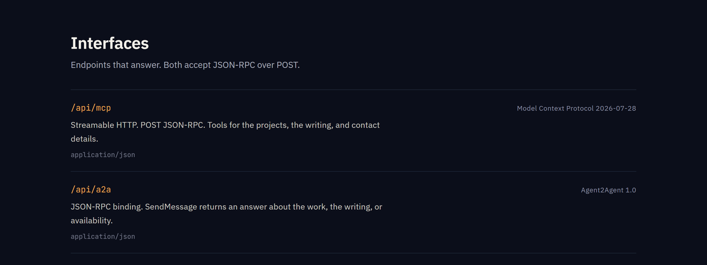
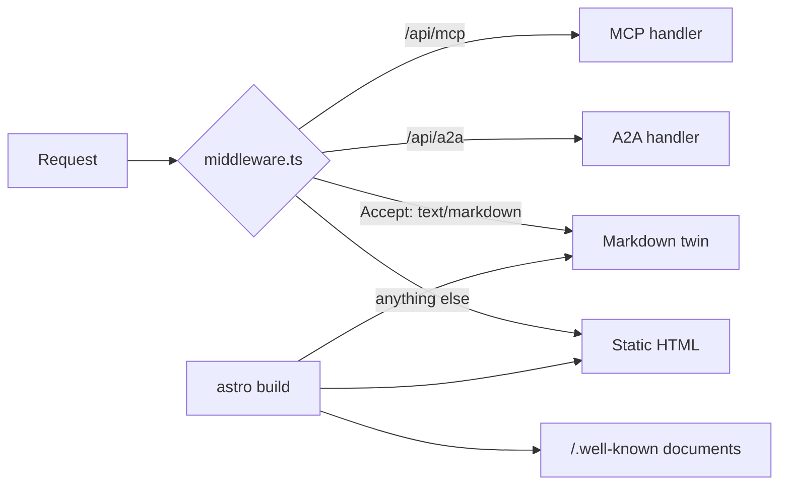

# jeffkazzee.dev

My portfolio site, which also answers AI agents directly.

Live: <https://jeffkazzee.dev>



Most sites make an agent scrape HTML. This one serves each page as Markdown on
request. It also exposes an MCP server, an A2A agent card and published agent
skills. See [/for-agents/](https://jeffkazzee.dev/for-agents/).

## What it does

- Lists my projects and writing, with status and links.
- Returns the Markdown version of a page when a client asks for `text/markdown`.
- Answers MCP and A2A requests about the work, the writing and availability.
- Publishes discovery documents under `/.well-known/`.
- Refuses to build a home-page project without a dated verification stamp.

## Try it from a terminal

Ask for a page as Markdown:

```sh
curl -s -H 'Accept: text/markdown' https://jeffkazzee.dev/projects/ | head -n 8
```

<!-- tested: 2026-11-06, curl on Windows against the live site, no project files -->

List the MCP tools:

```sh
curl -s -X POST https://jeffkazzee.dev/api/mcp \
  -H 'content-type: application/json' -H 'accept: application/json' \
  -d '{"jsonrpc":"2.0","id":1,"method":"tools/list","params":{}}'
```

<!-- tested: 2026-11-06, curl on Windows against the live site, no project files -->

| Tool | What it does |
| --- | --- |
| `list_projects` | Lists the projects with status, stack and links |
| `read_page` | Fetches a page of the site as Markdown |
| `list_writing` | Lists published writing, newest first |
| `contact_details` | Returns ways to contact me and what I am open to |



## How it works

The site has a static half and a runtime half.



- **Static.** `astro build` produces the pages, a Markdown twin of each page, a content index, `robots.txt` and `llms.txt`. `scripts/build-agent-surface.mjs` writes the well-known documents from data modules.
- **Runtime.** [`middleware.ts`](middleware.ts) is the only server-side code. It handles content negotiation and the two endpoints.
- **Headers.** Link and security headers live in [`vercel.json`](vercel.json), so they still apply if the middleware fails to deploy.

## Checks that protect the content

Three projects once described things that did not exist. Two dead URLs once sat
under the words "live right now". The site now derives those lists from checked
data.

- **`npm run verify:projects`** fetches each live URL and queries each repo. It fails on a 404 or a fork. The build refuses to ship a shelved project without its `verified:` stamp.
- **`npm run verify`** drives the MCP and A2A handlers and checks each discovery document against a real build.
- **`scripts/check-budget.mjs`** fails the build if a first phone visit to the home page passes 240 KB. An earlier measurement recorded about 88 KB. Not remeasured. <!-- source: scripts/check-budget.mjs, and the Speed section of the previous README -->

## Speed

The site is static HTML with no framework on the client.

- **Instant navigation.** Speculation rules render a page in the background after a hover of about 200 ms. Other browsers get Astro's hover prefetch.
- **No render-blocking requests.** CSS is inlined. Fonts are self-hosted, subset and scaled to match their fallbacks.
- **Native transitions.** `@view-transition` cross-fades pages with no JavaScript router.
- **Service worker.** Pages are network-first with a 3 second timeout, then the saved copy, then `/offline/`. It never handles `/api/` or `/.well-known/`.
<!-- source: public/sw.js, src/components/BaseHead.astro, previous README -->

## Run it

```sh
npm install
npm run dev
```

<!-- tested: 2026-11-06, clean clone on Ubuntu, Node 24.22.1, npm 11.19.0 -->

The dev server runs at `http://localhost:4321`.

Check the full build and the agent surface:

```sh
npm run build
npm run verify
```

<!-- tested: 2026-11-06, clean clone on Ubuntu, Node 24.22.1, npm 11.19.0 -->

`npm run verify` does not
exercise the deployed middleware. Run the terminal examples above against the
live origin after a deploy.

Content lives in `src/content/projects/` and `src/content/blog/`. To add an agent
skill, create `public/.well-known/agent-skills/<name>/SKILL.md`. The build hashes
it and adds it to the index.

## Stack

Astro, TypeScript and hand-written CSS, deployed on Vercel with Node 22.

## Status

Deployed at <https://jeffkazzee.dev>. On 2026-11-06 the home page, the Markdown
response, the MCP tool list and the agent card each answered from the live origin.

- Missing: DNS-AID records deploy separately from the site ([docs/dns-aid.md](docs/dns-aid.md)).

## License

No license file yet. Until one is added, all rights are reserved. The space images
are NASA, ESA, CSA and STScI images. The site credits each one where it appears.
